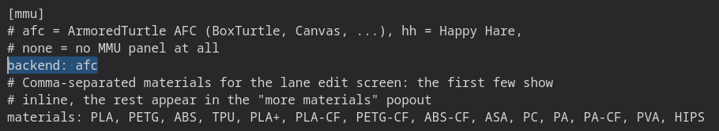

# AFC

Simple AF is adding full MMU support for AFC, initially this support is documenting how to install AFC and enable MMU panels in grumpyscreen, but we are working on docs and hooks and things to make
this support more streamlined and polished.

For more information head to <https://github.com/AFCProject/AFC-Klipper-Add-On>

!!! note

    For Simple AF for RPI follow the AFC official installation guide instead.

## CFS Support

    A community member is working on porting CFS to work with AFC, so far the results are looking promising, check out the issue <https://github.com/pellcorp/creality/issues/1709> to follow our progress.

## Install

!!! danger 
    
    You must clone to /usr/data/AFC-Klipper-Add-On, do NOT clone it to /root (or run git clone without the second argument), this can very easily brick your printer if /root fills up!

```
pip install crudini
git clone https://github.com/AFCProject/AFC-Klipper-Add-On.git  /usr/data/AFC-Klipper-Add-On
ln -s /usr/data/AFC-Klipper-Add-On /root
cd /root/AFC-Klipper-Add-On
./install-afc.sh -k /usr/data/klipper -m /usr/data/printer_data/config/moonraker.conf -y /usr/share/klippy-env/bin -p /usr/data/printer_data/config
```

!!! note

    The above approach will hopefully be greatly simplified soon as a few fixes have been made to the Creality OS support
    on the AFC repository but not released.

## Filament runout

AFC handles filament runout, we must remove the Simple AF filament runout detection otherwise your print will pause every time there is a filament swap

- You must remove the `[filament_switch_sensor filament_sensor]` from printer.cfg
- You must set `start_end.cfg` `[gcode_macro _CLIENT_VARIABLE]` `variable_runout_sensor` to ""

## Cut Macro

The `AFC_CUT` macro has a fatal flaw that can lead to collisions with the purge bracket on a K1 or K1 Max, there is a PR open to hopefully rectify that, but for now
use the AFC_CUT macro with extreme caution.

## Enable MMU in Grumpyscreen

To access the MMU panel in grumpyscreen you must modify the grumpyscreen.ini to enable your chosen backend:


Restart Grumpyscreen after making this change

!!! tip

    You can restart Grumpyscreen via the Services menu in Fluidd or Mainsail, you can also Restart GUI from Grumpyscreen

When you restart Grumpyscreen there will be a MMU icon on the left panel, it will be grayed out until klipper starts
and Grumpyscreen sees the required MMU configuration registered.



