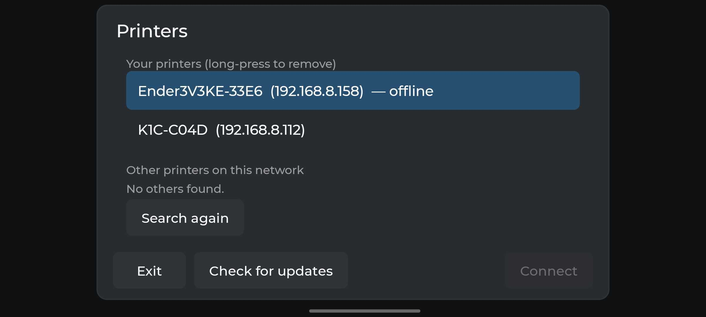
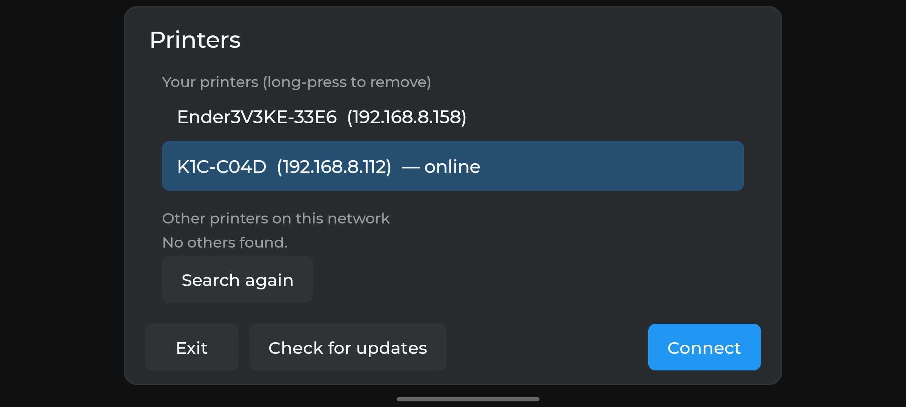
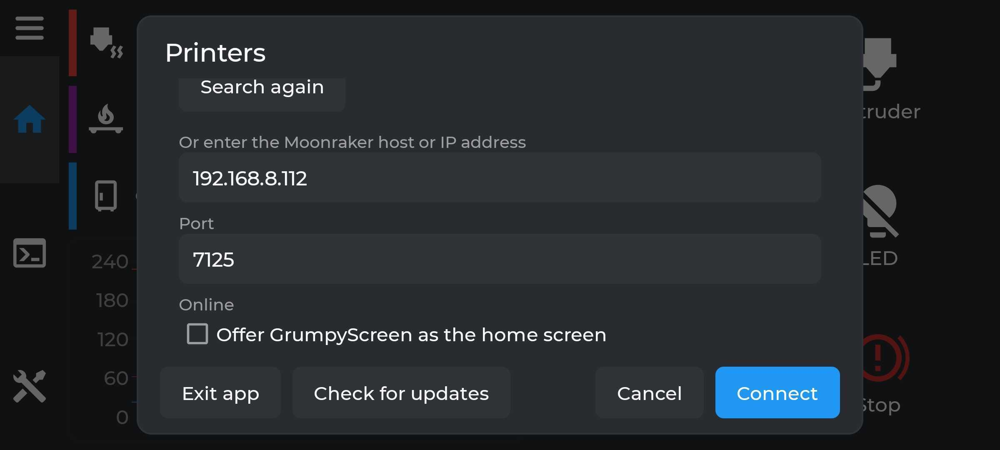
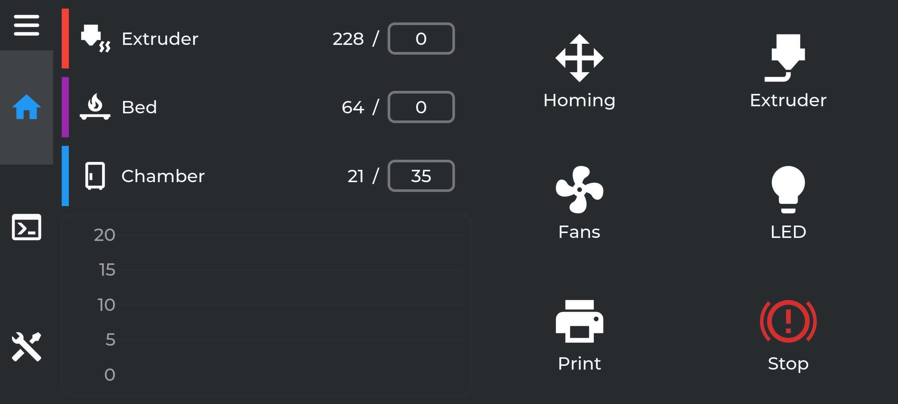

# GrumpyScreen for Android

Do you want a screen on your printer but don't want to buy a BBT screen?  You can repurpose an old android phone
and install GrumpyScreen for Android on there, phones and tablets back to Android 7.0 should work.

Grab the latest `grumpyscreen.apk` from <https://github.com/pellcorp/grumpyscreen/releases> and side load it onto your phone,
connect it to your printer(s).

## Configuration

For a consistent experience with on printer installation of GrumpyScreen, GrumpyScreen for Android is entirely configured by
a remote `grumpyscreen.ini` in the specific printers ~/printer_data/config directory.  You can tweak the config for a specific printer
and then reconnect to the printer via the Printers menu in GrumpyScreen for Android.   This means that you can have some printers which
have MMU or Spoolman configured whereas others do not, you can even configure different colours, but it is all done remotely via fluidd
or mainsail on your actual printer, there are **no plans** to expose this configuration in GrumpyScreen for Android.

## Connecting a Printer

When the app starts it will go searching for printers on your local network.

### Manually adding a printer

It is possible to manually add a printer, but at the moment its not actually that obvious how to do it, we will be working on making
that a bit more obvious, scroll down to see the `Or enter the Moonraker host or IP address` section

## The App

Its just the GrumpyScreen you might be used to, the Android app is directly using the native LVGL code within an Android application with
very few exceptions it will behave exactly the same as on a screen connected to the printer

## Bugs or Suggestions

It is early days, and we are continuing to refine the experience, bugs or feature requests can be reported to <https://github.com/pellcorp/grumpyscreen/issues>

