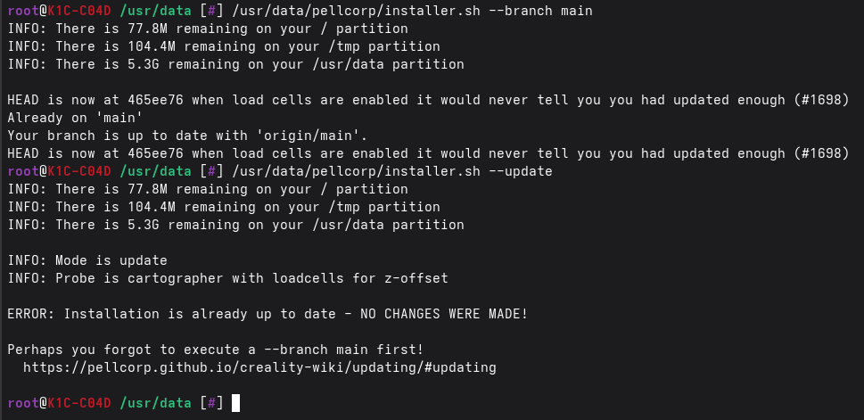
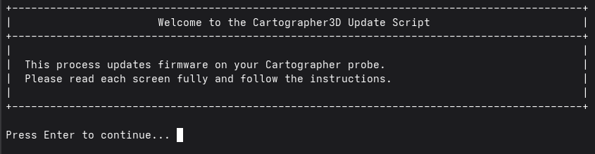
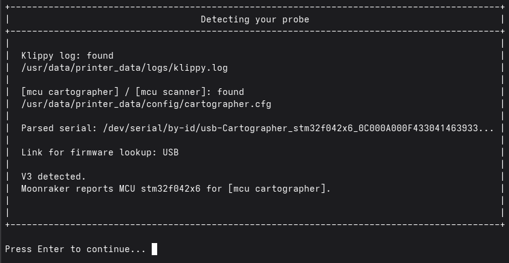
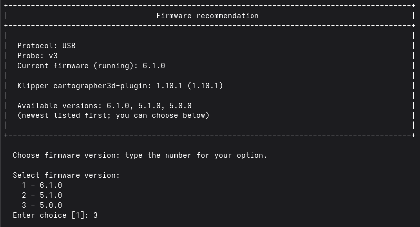
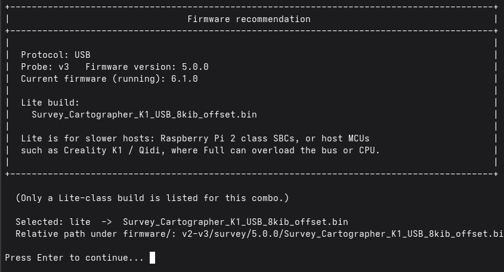
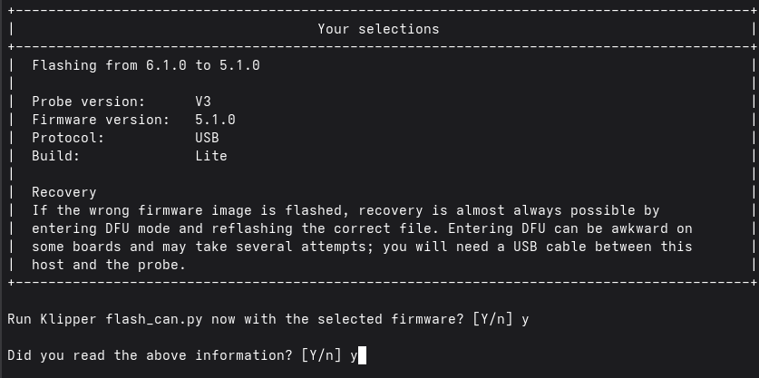
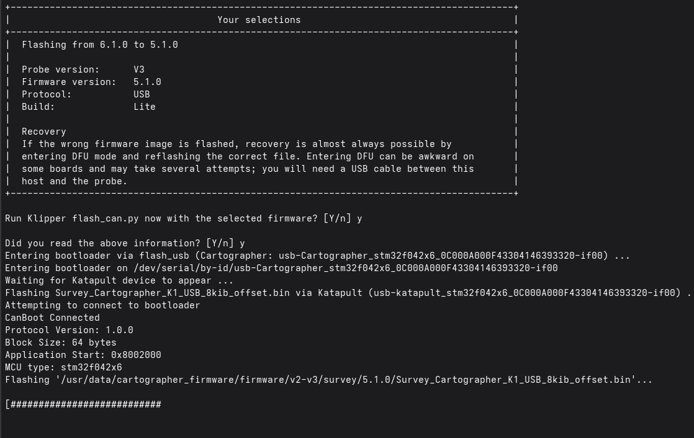
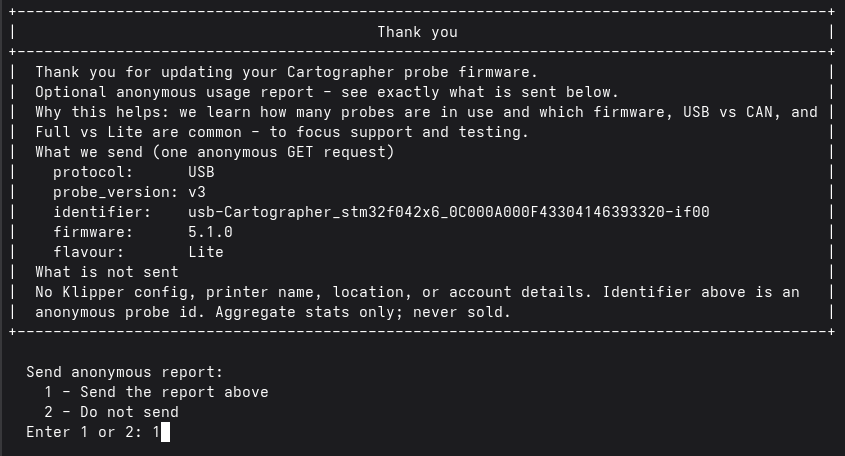
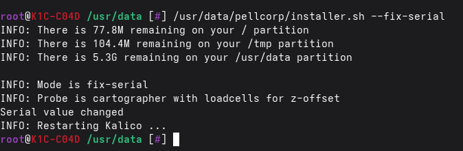

# Cartographer Flashing

We have introduced support for flashing the Cartographer V3 and V4 via the official cartographer3d.com tool.

!!! danger

    There is always the risk of soft bricking your cartographer with the following method, but never fear you can use [DFU mode](legacy_cartographer_flashing.md#flashing-via-dfu-mode) 

!!! note

    The [upstream doc](https://docs.cartographer3d.com/cartographer-probe/firmware/updating-firmware) mentions the need for a PI and to have cloned cartographer_firmware and katapult, this is **not** required
    for Simple AF as the installer clones those repos for you and we will be flashing directly on the printer.

Flashing the cartographer to have the K1 / Lite firmware **requires that you have installed Simple AF first**, you **must not**
flash the cartographer on the printer before Simple AF is installed!!!

!!! danger

    Any attempt to circumvent this and clone cartographer_firmware yourself onto the printer before installing Simple AF is very
    likely to soft brick your cartographer [requiring DFU mode](legacy_cartographer_flashing.md#flashing-via-dfu-mode)

Mount your cartographer onto the printer and connect it to USB and then get Simple AF installed first then come back to update the cartographer to have Lite firmware
before trying to use it.

## Updating the Firmware

If you already have Simple AF installed, and you want to update the firmware you should first of all make sure you are running the latest
version of Simple AF by running an update:

```
/usr/data/pellcorp/installer.sh --branch main
/usr/data/pellcorp/installer.sh --update
```



You want to see: `ERROR: Installation is already up to date - NO CHANGES WERE MADE!`, do NOT proceed with trying to update Cartographer
if you do not see that, failing to heed this warning will likely soft brick your cartographer [requiring DFU mode](legacy_cartographer_flashing.md#flashing-via-dfu-mode)

## Running the Cartographer FW Update script

After you have updated Simple AF you can run the firmware update script:

```
/usr/data/cartographer_firmware/fw_update.sh
```

The process will go through a few screens.

The first is the welcome screen:



Press Enter here!

Which should bring you to detecting your probe:



If all looks correct, press Enter again!

You should be greeted with a Firmware recommendation screen:



!!! note

    We recommend the following firmware versions, as ones we have tested extensively:

    - For V3 probes choose `5.0.0`
    - For V4 probes choose `6.0.0`

    Its quite likely newer firmware will work fine but we have never tested it!

Press Enter again!

You should be greeted with a confirmation screen like this:



If all looks correct, press Enter again!

You should be greeted with a your selection screen like this:



If all looks correct ...

Enter `y` at the `Run Klipper flash_can.py now with the selected firmware? [Y/n]` prompt and press Enter again!

Enter `y` at the `Did you read the above information? [Y/n]` prompt and press Enter again!

At this point its going to flash your cartographer



You will then be greeted with a request to send an anonymous report, please choose `1` and press Enter, it helps
the cartographer team to know how many people are using cartographers with K1 / Lite firmware.



You will then exit back out to the command prompt, at which time you should run the following:

```
/usr/data/pellcorp/installer.sh --fix-serial
```



If you see `INFO: Restarting Kalico` you can go back to Fluidd or Mainsail and wait for Kalico to restart,
if however it says: `Serial value is unchanged` you will need to force Kalico to restart yourself with:

```
/etc/init.d/S55klipper_service restart
```

!!! note

    Running the restart command will produce no output, but if you check Fluidd / Mainsail it should show
    Kalico is restarting.   Also please note even though it says `S55klipper_service` it is restarting Kalico!
