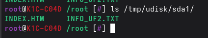
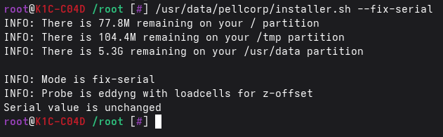
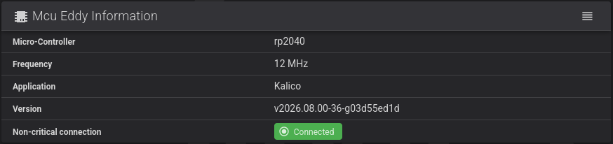

# EddyNG Flashing

!!! note

    The btteddy.uf2 supports btteddy and EddyNG

!!! tip "Flashing Btt DUO"

    Make sure to switch it to USB Mode first of all!!!

    It is possible this method will not work for the BTT Duo, especially if it is currently flashed for Can from the factory, 
    and you may need to resort to the legacy approach documented [here](legacy_eddyng_flashing.md)

## On Printer after installation

So it is possible to install Simple AF and flash your eddy afterward.

You need to hold down the boot button and re-connect your btt eddy to your printer, you will know this worked if you type `lsusb` and see:

```
Bus 001 Device 101: ID 2e8a:0003  USB2.0 Hub
```

!!! note

    We have noticed at least one Eddy probe tested does not show up as USB2.0 Hub but just as:

        Bus 001 Device 006: ID 2e8a:0003

    So just check to see if the `/tmp/udisk/sda1` mount exists instead is probably more reliable

Verify that the btt eddy has been mounted as a disk drive on the printer by running `ls /tmp/udisk/sda1`, you should see:



Once this has happened you will be able to copy the btteddy.uf2 file to the eddy via this command:

```
cp /usr/data/klipper/fw/K1/btteddy.uf2 /tmp/udisk/sda1/
```

If you check `lsusb` again, it should have switched back to:

```
Bus 001 Device 102: ID 1d50:614e OpenMoko, Inc. USB2.0 Hub
```

You might need to fix up the serial at this stage which you can do easily:

```
/usr/data/pellcorp/installer.sh --fix-serial
```



If you see `INFO: Restarting Kalico` you can go back to Fluidd or Mainsail and wait for Kalico to restart,
if however it says: `Serial value is unchanged` you will need to force Kalico to restart yourself with:

```
/etc/init.d/S55klipper_service restart
```

!!! note

    Running the restart command will produce no output, but if you check Fluidd / Mainsail it should show
    Kalico is restarting.   Also please note even though it says `S55klipper_service` it is restarting Kalico!


## On Printer before Install

You can flash the eddy on your printer (K1, K1C, K1SE, K1M, Ender 3 V3 KE, etc) but you need to be able to disconnect and reconnect it for this to work, there is currently no way to get the eddy into boot mode any other way!

So by default when connecting the btt eddy to the printer, `lsusb` will report:

```
Bus 001 Device 099: ID 1d50:614e OpenMoko, Inc. USB2.0 Hub
```

This means it is not in boot mode and you cannot flash any firmware to it.  You need to hold down the boot button and re-connect your btt eddy to your K1, you will know this worked if you type `lsusb` and see:

```
Bus 001 Device 101: ID 2e8a:0003  USB2.0 Hub
```

!!! note

    We have noticed at least one Eddy probe tested does not show up as USB2.0 Hub but just as:

        Bus 001 Device 006: ID 2e8a:0003

    So just check to see if the `/tmp/udisk/sda1` mount exists instead is probably more reliable

Verify that the btt eddy has been mounted as a disk drive on the printer by running `ls /tmp/udisk/sda1`, you should see:


Once this has happened you will be able to copy the btteddy.uf2 file to the eddy via this command:

```
wget --no-check-certificate https://raw.githubusercontent.com/pellcorp/kalico/aug2026/fw/K1/btteddy.uf2 -O /tmp/btteddy.uf2
cp /tmp/btteddy.uf2 /tmp/udisk/sda1/
```

If you check `lsusb` again, it should have switched back to:

```
Bus 001 Device 102: ID 1d50:614e OpenMoko, Inc. USB2.0 Hub
```

## Flashing on Windows or Linux Desktop

### Connecting in BOOTSEL mode

You need to connect your btt eddy to your computer in BOOTSEL mode, you do this by disconnecting the eddy usb **or eddy duo**, and then push and hold boot button on Eddy (It's next to where the cable plugs in) and at the same time, plug in the cable to your computer.

On windows or a Linux Desktop if you successfully connected the eddy in bootsel mode, it will be mounted as a new drive on your computer.

### Flashing btteddy.uf2 file

Copy the [btteddy.uf2](https://raw.githubusercontent.com/pellcorp/kalico/aug2026/fw/K1/btteddy.uf2) file across to the btt eddy drive, it should automatically flash the eddy and disconnect for you.

Once this is done go ahead and reconnect your eddy to your printer.

## How do I know it flashed correctly?

Unfortunately we know of no way to test this except by plugging it back into the printer, restarting klipper and verifying via the System tab, a correctly flashed eddy will have


