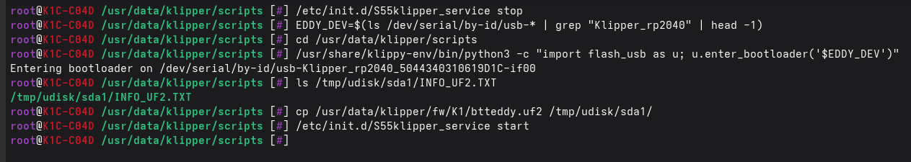

# EddyNG Flashing

!!! note

    The btteddy.uf2 supports btteddy and EddyNG

!!! tip "Flashing Btt DUO"

    Make sure to switch it to USB Mode first of all!!!

    It is possible this method will not work for the BTT Duo, especially if it is currently flashed for Can from the factory, 
    and you may need to resort to the legacy approach documented [here](legacy_eddyng_flashing.md)

## Flashing via bootloader

This only works if the BTT Eddy has an existing version of klipper installed, but you can get the eddy into boot mode like this:

```
EDDY_DEV=$(ls /dev/serial/by-id/usb-* | grep "Klipper_rp2040" | head -1)
cd /usr/data/klipper/scripts
/usr/share/klippy-env/bin/python3 -c "import flash_usb as u; u.enter_bootloader('$EDDY_DEV')"
```

!!! danger

    The `EDDY_DEV=$(ls /dev/serial/by-id/usb-* | grep "Klipper_rp2040" | head -1)` might match more than one MCU if you have a MMU or on RPI series something like a SKR Pico basically anything
    with a rp2040 processor, so you might need to manually determine your EDDY_DEV some other way.

You need to wait for `ls /tmp/udisk/sda1/INFO_UF2.TXT` to work before carrying out the next step:

```
cp /usr/data/klipper/fw/K1/btteddy.uf2 /tmp/udisk/sda1/
```

If you check `ls /tmp/udisk/sda1` again, it should have disappeared



You might need to fix up the serial at this stage which you can do easily:

```
/usr/data/pellcorp/installer.sh --fix-serial
```


If you see `INFO: Restarting Kalico` you can go back to Fluidd or Mainsail and wait for Kalico to restart,
if however it says: `Serial value is unchanged` you will need to force Kalico to restart yourself with:

```
/etc/init.d/S55klipper_service restart
```

!!! note

    Running the restart command will produce no output, but if you check Fluidd / Mainsail it should show
    Kalico is restarting.   Also please note even though it says `S55klipper_service` it is restarting Kalico!


## How do I know it flashed correctly?

Unfortunately we know of no way to test this except by plugging it back into the printer, restarting klipper and verifying via the System tab, a correctly flashed eddy will have


