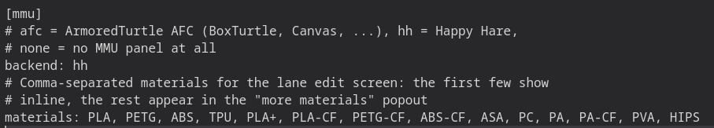
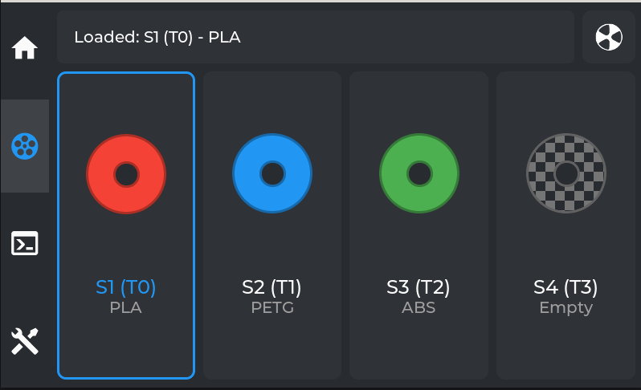

# Happy Hare

Simple AF is adding full MMU support for Happy Hare, initially this support is documenting how to install Happy Hare and enable MMU panels in grumpyscreen, but we are working on docs and hooks and things to make
this support more streamlined and polished.

For more information head to <https://github.com/moggieuk/Happy-Hare>

!!! tip

    Happy Hare v4.1+ supports the version of Kalico we are currently running.

!!! note

    For Simple AF for RPI follow the Happy Hare official installation guide instead.

## Install

The default installer needs to be executed with some different arguments

!!! danger

    You must clone to /usr/data/Happy-Hare, do NOT clone it to /root (or run git clone without the second argument), this can very easily brick your printer if /root fills up!

So first of all clone the repo:

```
git clone https://github.com/moggieuk/Happy-Hare.git /usr/data/Happy-Hare
```

Then run the installer:

```
cd /usr/data/Happy-Hare
CONFIG_SERVICE_MOONRAKER=S56moonraker_service CONFIG_SERVICE_KLIPPER=S55klipper_service ./install.sh -i
```

## Filament runout

TODO

## Enable MMU in GrumpyScreen

To access the MMU panel in grumpyScreen you must modify the grumpyscreen.ini to specify `backend: hh`:



Restart GrumpyScreen after making this change

!!! tip

    You can restart GrumpyScreen via the Services menu in Fluidd or Mainsail, you can also Restart GUI from GrumpyScreen

When you restart GrumpyScreen there will be a MMU icon on the left panel, it will be grayed out until klipper starts
and GrumpyScreen sees the required MMU configuration registered.


