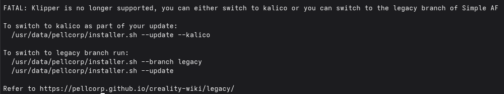

# Legacy SimpleAF

As of October 20th Australian Eastern Daylight time, we are desupporting Klipper and hard migrating to Kalico which has been
in the works for months.

To allow existing users to update to the latest code before the switch was made, we have created a legacy branch of Simple AF
which will allow you to get updates up until the very latest before the switch was made.

## Why?

See [Kalico](kalico.md)
