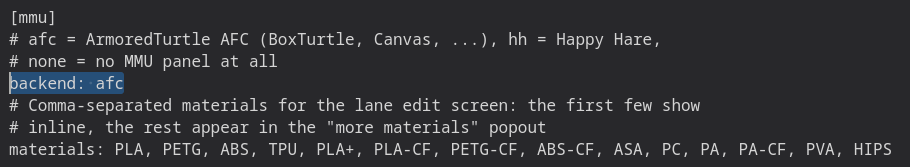
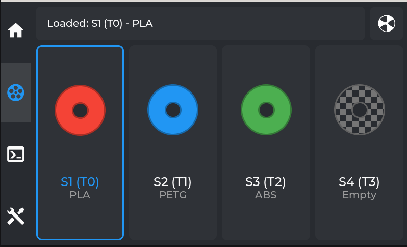

# Multimaterial Support

Simple AF is adding full MMU support for either AFC or HH, initially this support is documenting how
to install AFC and HH and enabling MMU panels in grumpyscreen.

!!! note

    A community member is working on porting CFS to work with AFC, so far the results are looking promising, we will update the wiki
    if we get to a point where we are comfortable release the code!

## Install AFC

!!! note

    This does not apply to Simple AF for RPi

First of all clone the repo, you must clone it to /usr/data, do NOT clone it to /root:

```
pip install crudini
git clone https://github.com/AFCProject/AFC-Klipper-Add-On.git  /usr/data/AFC-Klipper-Add-On
ln -s /usr/data/AFC-Klipper-Add-On /root
cd /root/AFC-Klipper-Add-On
./install-afc.sh -k /usr/data/klipper -m /usr/data/printer_data/config/moonraker.conf -y /usr/share/klippy-env/bin -p /usr/data/printer_data/config
```

!!! warning

    The above approach will hopefully be greatly simplified soon as a few fixes have been made to the Creality OS support
    on the AFC repository but not released.

## Install Happy Hare

!!! note

    This does not apply to Simple AF for RPi

The default installer needs to be executed with some different arguments

So first of all clone the repo:

```
git clone https://github.com/moggieuk/Happy-Hare.git /usr/data/Happy-Hare
```

Then run the installer:

```
cd /usr/data/Happy-Hare
./install.sh -k /usr/data/klipper -c /usr/data/printer_data/config -z -m /usr/data/moonraker -e
systemctl restart moonraker
systemctl restart klipper
```

## Enable MMU in Grumpyscreen

To access the MMU panel in grumpyscreen you must modify the grumpyscreen.ini to enable your chosen backend:



Restart Grumpyscreen after making this change

!!! tip

    You can restart Grumpyscreen via the Services menu in Fluidd or Mainsail, you can also Restart GUI from Grumpyscreen

When you restart Grumpyscreen there will be a MMU icon on the left panel, it will be grayed out until klipper starts
and Grumpyscreen sees the required MMU configuration registered.



