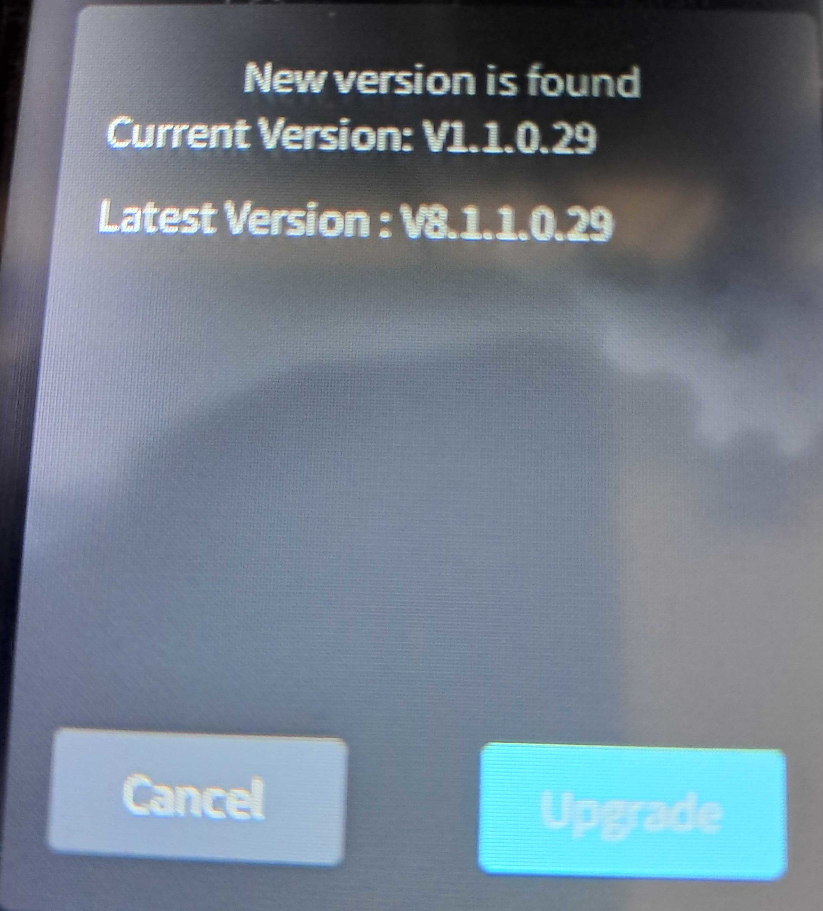
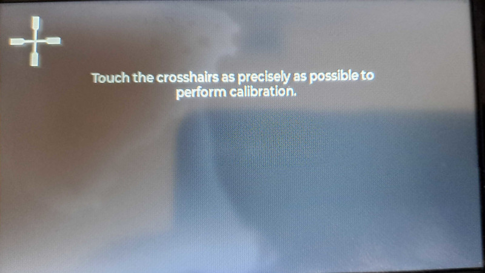
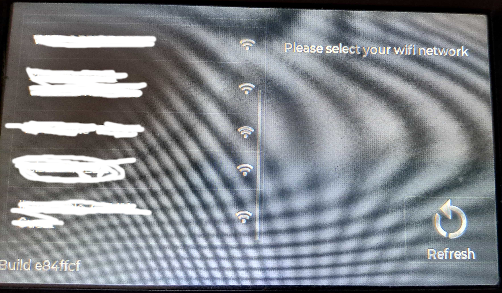
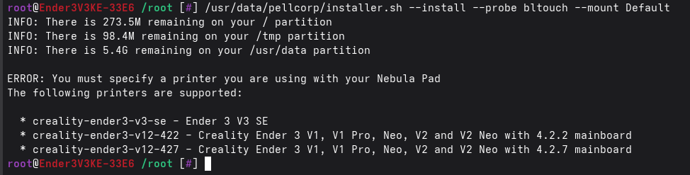

# Simple AF on a Nebula Pad

Support for running Simple AF with a retail Nebula Pad for some older Ender 3 printers.

## Nebula Pad mount

The Nebula Pad **must** be mounted onto the printer in landscape mode

## Supported Printers

- Ender 3 V1 and V1 Pro with 4.2.2 mainboard (`--printer creality-ender3-v12-422`)
- Ender 3 V1 and V1 Pro with 4.2.7 mainboard (`--printer creality-ender3-v12-427`) **UNTESTED**
- Ender 3 Neo with 4.2.7 mainboard (`--printer creality-ender3-v12-427`) **UNTESTED**
- Ender 3 V2 with 4.2.2 mainboard (`--printer creality-ender3-v12-422`)
- Ender 3 V2 with 4.2.7 mainboard (`--printer creality-ender3-v12-427`) **UNTESTED**
- Ender 3 V2 Neo with 4.2.7 mainboard (`--printer creality-ender3-v12-427`) **UNTESTED**
- Ender 3 V3 SE (`--printer creality-ender3-v3-se`)

The following additional printers are planned for the near future:

- Ender 3 S1
- Ender 3 S1 Pro
- Ender 3 Max Neo

!!! note

    Additional printers that can be connected via the IDC display port will be added if requested

## Printer Firmware

You will need to flash your printer with klipper firmware in the way that each printer needs to be flashed, usually
this will entail copying the bin file to a SD or Micro SD card and placing into the printer and restarting the printer, you should not
have the printer connected to the Nebula Pad at this stage.

### Creality 4.2.2 and 4.2.7

This firmware works for STM32 and GD32 variants of the boards

The firmware <https://github.com/pellcorp/kalico/raw/refs/heads/aug2026/fw/NEBULA/creality-42x.bin>

Copy the firmware bin file to the root of your SD-Card and rename to a unique filename in 8.3 format, something you have not flashed before, such as fw-1113.bin.

### Ender 3 V3 SE

The Ender 3 V3 SE is a bit painful to flash, and it depends on which version of the board you have (C13 vs C14)

| Mainboards                | URL                                                                        | 
|---------------------------|----------------------------------------------------------------------------|
| Ender 3 V3 SE (C13 Board) | <https://github.com/pellcorp/kalico/blob/aug2026/fw/NEBULA/e3v3se.bin>     | 
| Ender 3 V3 SE (C14 Board) | <https://github.com/pellcorp/kalico/blob/aug2026/fw/NEBULA/e3v3se-c14.bin> |

#### C13 Board

!!! danger

    Flashing the C14 firmware to a C13 board is very likely to brick it because the C13 has a 28KB bootloader offset amongst other differences.

Copy the firmware bin file to the root of your SD-Card and rename to a unique filename in 8.3 format, something you have not flashed before, such as fw-1113.bin.

#### C14 Board

!!! danger

    Flashing the C13 firmware to a C14 board is very likely to brick it because the C14 has a 64KB bootloader offset amongst other differences.

Copy the firmware bin file to a folder `STM32F4_UPDATE` on your SD-Card and rename to a unique filename in 8.3 format something you have not flashed before, such as fq-1115.bin.

## SimpleAF Base Firmware

You must install the Simple AF base nebula firmware.

Download the [NEBULA_ota_img_V8.1.1.0.29.img](https://github.com/pellcorp/downloads/raw/refs/heads/main/creality/simpleaf/NEBULA_ota_img_V8.1.1.0.29.img) and save it to a Fat32 formatted USB Key and insert it into your Nebula Pad.

After you finish flashing the SimpleAF base firmware, you must [factory reset your Nebula Pad](nebula_factory_reset.md) before proceeding to install
Simple AF, the installer will abort if it detects you have not factory reset!

!!! note

    WIFI settings should be retained if you use the Simple AF factory reset method

You have a few options for flashing the firmware to your Nebula Pad

### Flash the firmware from the stock UI

The stock UI should prompt you to install the updated firmware when the USB is inserted!



### Via the command line on the printer

You will need root access to the printer, and then run this command:

```
/etc/ota_bin/local_ota_update.sh /tmp/udisk/sda1/NEBULA_ota_img_V8.1.1.0.29.img
```

### Ingenic Cloner

You can download the ingenic image from:
<https://github.com/pellcorp/downloads/blob/main/creality/simpleaf/NEBULA_8.1.1.0.29.ingenic>

## First start

### Touch Calibration

When you start the Nebula Pad after installing the SimpleAF Base Firmware you will be a asked to complete touch calibration, follow the
steps to get that done



### Setup WIFI

If you already had Wi-Fi setup before flashing the new firmware, your details might have been retained, if not you will need to
set them up again via the Wi-Fi panel or [Configure WIFI via USB](configure_wifi.md)



### Logging in

Once WIFI is connected you can login as root via ssh:

```
ssh root@THE_IP_ADDRESS
```

The password is `Creality2023`

## Installing SimpleAF



The instructions for installing SimpleAF for a bltouch just need to have a --printer argument added, so for example to install for an Ender 3 V1 with a 4.2.2 mainboard, 
you would clone the repo and then run the installer:

```
git config --global http.sslVerify false
git clone https://github.com/pellcorp/creality.git /usr/data/pellcorp
/usr/data/pellcorp/installer.sh --install bltouch --mount Default --printer creality-ender3-v12-422
```

!!! note

    The `--mount Default` will configure bltouch for the Creality supplied bltouch mount with the stock hotend, you could also specify `--mount SpritePro` to
    setup a printer with the Sprite Pro and the provided bltouch mount.

## Restoring original firmware

If you decide you don't like Simple AF on your Nebula Pad, you should [factory reset](emergency_factory_reset.md) which will return you to the Wi-Fi bootstrap screen, where you will be prompted to calibrate touch again, if you are going
back to stock firmware, don't worry about doing the touch calibration, just go ahead and SSH into the machine (Wi-Fi settings should have been retained)

You can either grab the original firmware from Creality or [our pre-rooted firmware](prerooted_firmware.md), put that onto a USB key, and plug the USB key into the machine.

Run this command if you downloaded the pre-rooted but otherwise stock firmware:

```
/etc/ota_bin/local_ota_update.sh /tmp/udisk/sda1/NEBULA_ota_img_V7.1.1.0.29.img
```

Restart the Nebula Pad and it should prompt you to setup your printer again.
